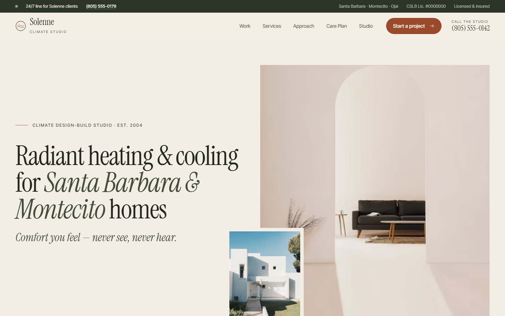

<div align="center">

# Solenne Climate Studio

**Radiant heating & cooling for Santa Barbara & Montecito homes**

A bespoke website concept for a design-build climate studio specializing in radiant systems, air-to-water heat pumps and quiet ventilation.


</div>



> [!NOTE]
> **Design concept.** Solenne Climate Studio is a fictional company created for portfolio purposes. Names, phone numbers (555), the `.example` domain and the license number are placeholders. No reviews or ratings are invented: review areas are clearly marked widget slots.

---

## Overview

Solenne designs, installs and cares for climate systems in architect-designed homes along the Central Coast, from Hope Ranch to the Ojai Valley. Its philosophy is *comfort you feel, never see, never hear*, and the site is built to make that idea tangible.

The visual direction is light architectural minimalism: warm limestone backgrounds, deep olive type, a trace of terracotta for calls to action, an asymmetric editorial grid and offset image captions. It reads like an architecture magazine rather than a contractor brochure.

## Pages

| Page | File | What it does |
|---|---|---|
| Home | `index.html` | Hero, credentials strip, philosophy, featured work, hand-drawn SVG system section, process timeline, measured outcomes, reviews slot, offers + quick form |
| Work | `work.html` | 8 projects with working filters (New Residence / Renovation / Hospitality & Commercial) |
| Case study | `work-montecito-residence.html` | Olive Grove Residence: facts, outcomes, narrative, lightbox gallery, before/after energy bars |
| Approach | `approach.html` | Six-phase design-build process, systems explained with a homeowner/architect toggle, FAQ |
| Radiant Heating & Cooling | `radiant-heating-cooling.html` | Dedicated service page with spec card and FAQ |
| Air-to-Water Heat Pumps | `air-to-water-heat-pumps.html` | Service page with gas-to-electric retrofits and incentives guidance |
| Montecito | `montecito.html` | City page: marine layer, creekside rebuilds, estate properties, quiet nights |
| Care Plan | `care-plan.html` | Three membership tiers (Seasonal, Monitored, Estate) |
| Studio | `studio.html` | Story, values, team, SVG service-region map, credentials |
| Contact | `contact.html` | Three-step inquiry form with progress indicator |
| Thank you | `thank-you.html` | Personalized confirmation with next steps |

## Features

- **Hand-drawn SVG section** of a house showing heat pump, buffer tank, radiant slab, radiant ceiling and ERV, with animated flow lines
- **Multi-step inquiry form** with step validation, role-aware copy and a summary on success
- **Audience switch** on the Approach page that explains each system for homeowners or architects
- **Before/after energy bars** that animate into view on the case study
- **Filterable work index** with deep links (`work.html#renovation`)
- **Lightbox gallery** with keyboard navigation
- **Sticky mobile action bar** and an accessible full-screen menu
- **Structured data**: `HVACBusiness` on every page, plus `Service` and `FAQPage` where relevant

## Design system

| Token | Value | Use |
|---|---|---|
| Limestone | `#f3eee5` | Page ground |
| Paper | `#faf7f1` | Cards and panels |
| Ink | `#22261f` | Body copy |
| Olive | `#414b38` | Emphasis, icons |
| Clay | `#b0603c` | Accents and calls to action |

**Type:** Instrument Serif (display) with Inter Tight (UI and body), via Google Fonts.

## HVAC conversion checklist

Built against a conversion checklist drawn from top-performing HVAC sites, adapted for a high-end studio:

- [x] Call and booking visible without scrolling on mobile
- [x] Sticky mobile call/book bar
- [x] Credentials and rating slot directly under the hero
- [x] Incentives and Care Plan offers placed beside the quick form
- [x] Separate service pages and a unique city page
- [x] `HVACBusiness` schema on every page
- [x] Quick form with 5 fields or fewer, plus a thank-you page
- [x] License, insurance and trade affiliations shown
- [x] 24/7 line for existing clients

## Run locally

No build step or dependencies are needed. Serve the folder with any static server:

```bash
python -m http.server 8000
```

Then open <http://localhost:8000>. You can also open `index.html` directly in a browser.

## Project structure

```text
solenne-climate/
├── index.html
├── work.html
├── work-montecito-residence.html
├── approach.html
├── radiant-heating-cooling.html
├── air-to-water-heat-pumps.html
├── montecito.html
├── care-plan.html
├── studio.html
├── contact.html
├── thank-you.html
├── css/
│   └── styles.css
├── js/
│   └── main.js
└── docs/
    └── preview.png
```

## Credits

- Photography from [Unsplash](https://unsplash.com), used under the Unsplash License. A production site would use the client's own project photography.
- Fonts from [Google Fonts](https://fonts.google.com).
